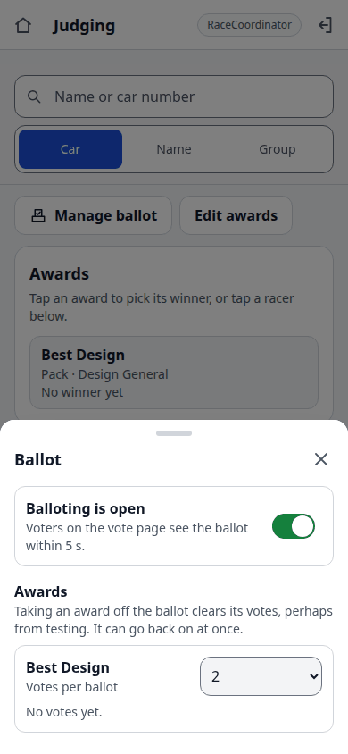
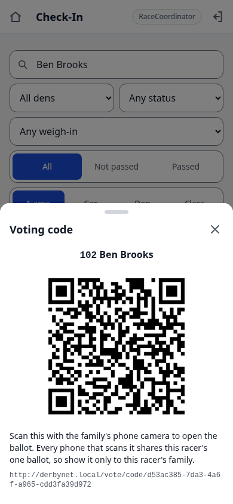
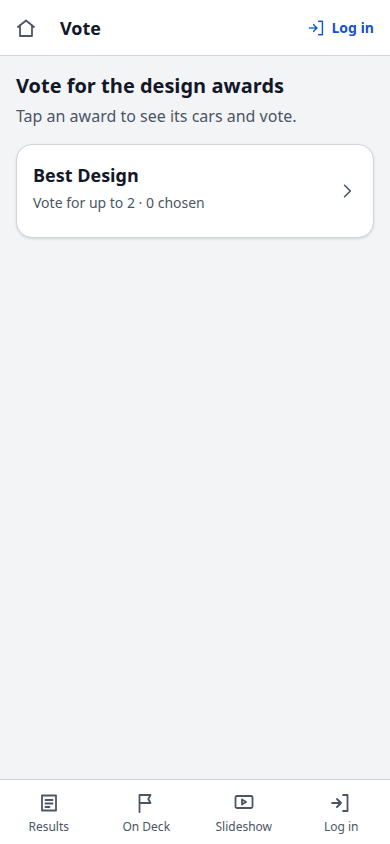
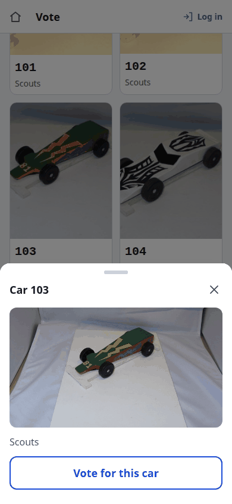
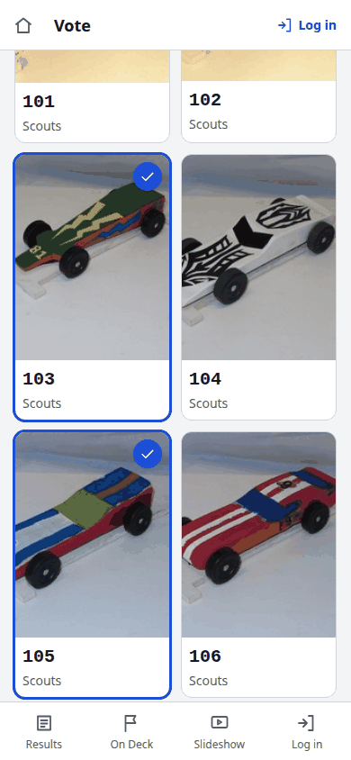
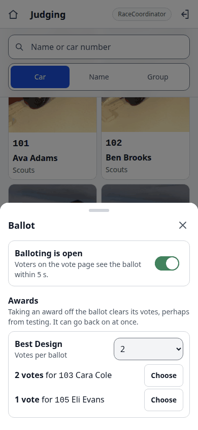

# Online balloting

Besides the speed awards, many packs give design awards, such as "Best Design" or "Most Creative". A judge or a panel usually picks the winners. With online balloting, the families vote on them from their own phones instead. Quoted words below are the labels on the screen.

Each racer has a voting code, a QR code the check-in crew shows to the racer's family. The code is the family's ballot (D86). Every phone that scans the same code edits the same one ballot, so passing the code around never adds a vote. There is no password and no final submit: each tap counts at once, and reopening the code shows the choices again.

Take a car photo of every car. Voters choose from the cars' photos, and with no photo they see only the car number.

## Put awards on the ballot

1. Add the design awards: Judging, then "Edit awards", then "New award". [Running a race](running-a-race.md#add-the-awards) shows the step.
2. On Judging, press "Manage ballot".
3. Under "Awards", set each award's "Votes per ballot". "Not on ballot" leaves the award to the judges. A number is how many cars each ballot may choose for that award. A young racer may vote for their own car, so two or three votes each lets the other votes count.
4. Turn on "Balloting is open". Voters see the ballot within 5 seconds.

Taking an award off the ballot clears its votes, such as votes cast while testing. The award can go back on at once.

## Hand out the voting codes

At check-in, each racer's card has "Voting code". It opens the racer's QR code, with its link below. The family scans it with their phone's camera, and the ballot opens there.

Show each code only to its racer's family: anyone with the code votes on that racer's ballot. The codes stay the same all day, so a family can scan theirs at check-in and vote later.

## Vote

The ballot lists the awards to vote on, and how many cars each one takes.

Tap an award to see its cars. Tap a car to see its photo, and press "Vote for this car". The button then reads "Voted. Tap to remove", and a second tap takes the vote back.

The cars voted for carry a check mark and "Your vote", and the award shows how many are chosen.

While balloting is not open, before or after the vote, the page says "Voting is closed", and to keep it open: it opens the ballot by itself when voting starts. "Vote" in the menu, with no code, says to scan a racer's voting code.

## Count the votes

On Judging, "Manage ballot" shows each award's votes, the car with the most first. Press "Choose" beside a car to give it the award. The judges still decide: they may break a tie, or give the award to another car on Judging as for any award.

Turn off "Balloting is open" to end the vote. Present the winners with Present Awards, as for any award ([Running a race](running-a-race.md#present-the-awards)).

## Voting codes and snapshots

A snapshot or an export from this server keeps each racer's voting code, so the codes and the ballot survive a restore or a move to another server (D87). A snapshot written by an older DerbyNet has no codes, and importing it gives each racer a new one.
