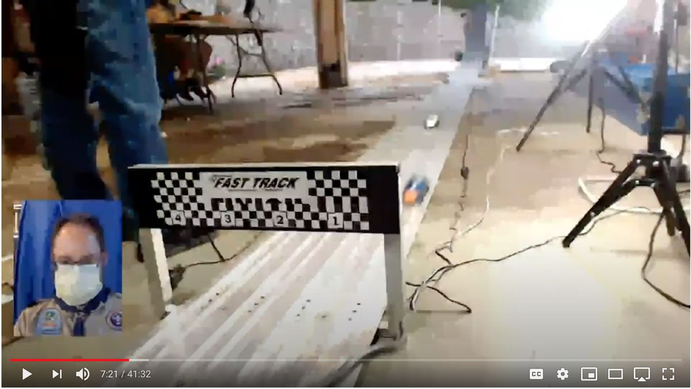
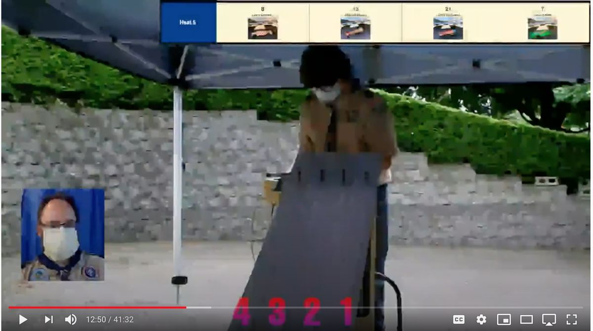
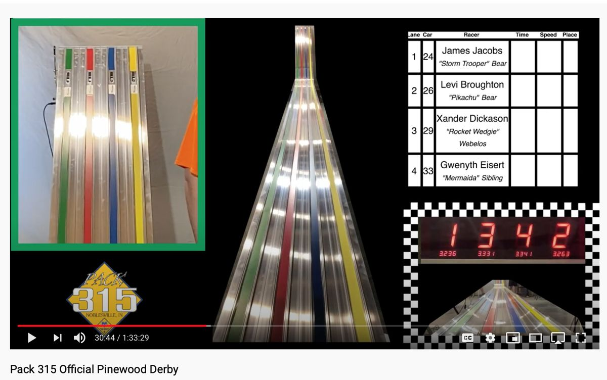

# Live streaming DerbyNet with OBS

Some packs stream their race to families at home. This guide gives tips for streaming a race with DerbyNet and OBS, the Open Broadcaster Software (<https://obsproject.com/>). Most of them apply to other streaming programs too.

## Set-up tips

### USB cable lengths and power

A passive USB 2.0 cable works up to about 5 meters, or 16 feet. Longer cables may work, but nothing promises it. A track can be 40 or 50 feet long, so a camera at each end may be too far from one computer. Use powered USB hubs, or active repeater cables, or both.

An active repeater cable draws power of its own, as well as the power of the camera at its end. A laptop's USB port may not supply enough for both. A powered hub beside the repeater cable avoids an undervoltage at the camera. A USB power meter shows whether a camera gets enough.

### Bit rates

OBS starts with low bit rates. For better video, use the bit rate your streaming service recommends. YouTube lists its own at <https://support.google.com/youtube/answer/2853702>.

### Wi-Fi

Prefer Ethernet to Wi-Fi where you have the choice. Many people stream over Wi-Fi with no trouble, but a cable avoids radio interference.

### Switch scenes with a USB keypad

OBS can switch scenes with hot keys. Assign the hot keys to a cheap USB keypad, and your emcee can switch scenes with little instruction.

### Take events from derby-timer.jar

`derby-timer.jar` can connect to OBS's websocket, and send a request when a heat starts and when it finishes, such as a hot key that changes the scene. The browser timer cannot.

Give `derby-timer.jar` the websocket's address with `-obs-uri`, and its password, if it has one, with `-obs-password`. Name the hot key for a heat's finish with `-obs-finish`, and for its start with `-obs-start`:

```sh
java -jar derby-timer.jar -obs-uri ws://192.168.0.12:4444 -obs-password secret -obs-finish OBS_KEY_NUM2
```

`-obs-start` and `-obs-finish` each take one of two forms:

- The name of a hot key, from the list in OBS's `obs-hotkeys.h` (<https://github.com/obsproject/obs-studio/blob/master/libobs/obs-hotkeys.h>). This form takes no key modifiers.
- `@` and a file name. The file holds a whole websocket request, in OBS's websocket protocol.

Many timers report only a heat's finish, so `-obs-start` works only with a timer that reports the gate opening.

## DerbyNet pages in OBS

### A kiosk page in a browser source

The race coordinator controls each kiosk from the Kiosk Dashboard. A browser source in OBS is a kiosk too. Give it an address of its own in its URL, such as `http://192.168.1.20/kiosk.php?address=obs-inset`, and it appears on the Kiosk Dashboard as a kiosk. Choose its page there, as for any kiosk. Give it a name there too, and the scenes choose its page.

To pin a browser source to one page, add a `page` parameter to the URL instead. Such a source does not show on the Kiosk Dashboard, and always shows that page:

```
http://192.168.1.20/kiosk.php?page=kiosks/now-racing.kiosk
```

The pages are `award-presentations`, `derbynet`, `flag`, `identify`, `now-racing`, `now-racing-columnar`, `now-racing-columnar-reversed`, `ondeck`, `please-check-in`, `qrcode`, `results-by-racer`, `scale-MPH`, `slideshow`, `standings` and `welcome`, each as `kiosks/NAME.kiosk`.

Kiosk pages need no login, and use plain HTTP.

DerbyNet no longer uses the websocket server of earlier versions, `extras/websocket/ws-server.js` (D21). Kiosks need nothing besides the DerbyNet server.

### Voting for awards

An audience at home can vote for the awards your judges leave to them, such as "Coolest Car". Each racer's voting code lets the family vote from a phone.

## Scene ideas

### Track view

While a heat runs, your audience most wants to see the track. Put a camera near the finish line, aimed along as much of the track as it can see. Add a "Now Racing" page as an inset, to show who is in each lane, and an inset of your emcee if you like.



### Starting gate

With a second camera, show the start of the track, so the audience sees the cars staged. Add the "On Deck" or "Now Racing" page as an inset. If the lanes do not read left to right in this view, lay lane labels over the video.



### Kiosk scenes

Make a scene that is mostly or only a kiosk page. Two such scenes help: one with an inset of the emcee, and one with the kiosk alone.

An OBS browser source cannot take clicks or typing, so a page you must set up by hand, such as replay, needs a "Window Capture" or "Display Capture" source instead. On macOS, a "Window Capture" source can flicker. "Display Capture" avoids it, best with a second display on the Mac.

### All in one

This scene uses an OBS image mask to combine several sources.



## Replay on the streaming computer

DerbyNet's replay page records each heat and plays it back in slow motion. It takes a lot of computing power, and so does OBS. One laptop may not keep up with both: the stream drops frames, and the replay stutters.

Run replay on a second computer, and capture its screen, or use OBS's own replay instead, such as the "Replay Source" plug-in (<https://obsproject.com/forum/resources/replay-source.686/>).
