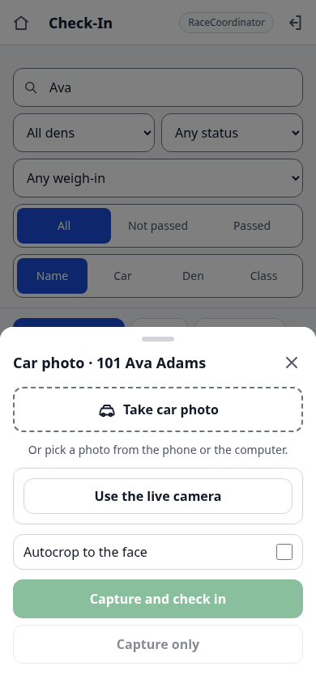
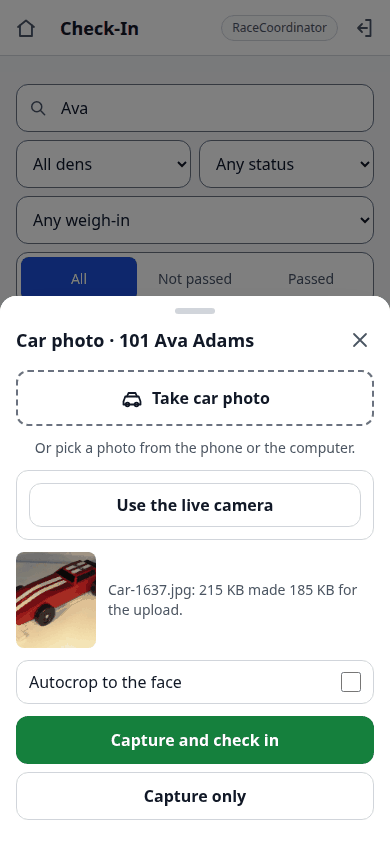
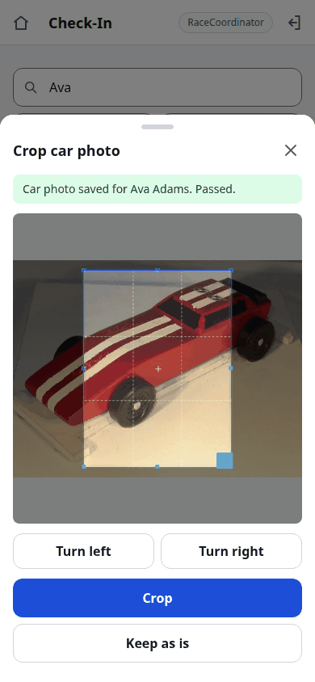
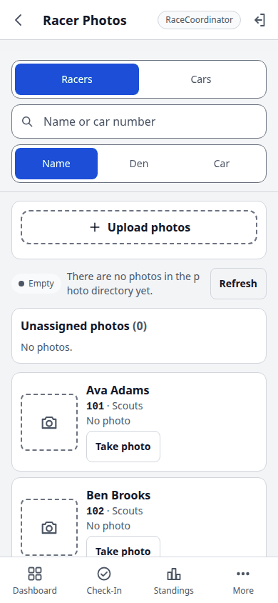
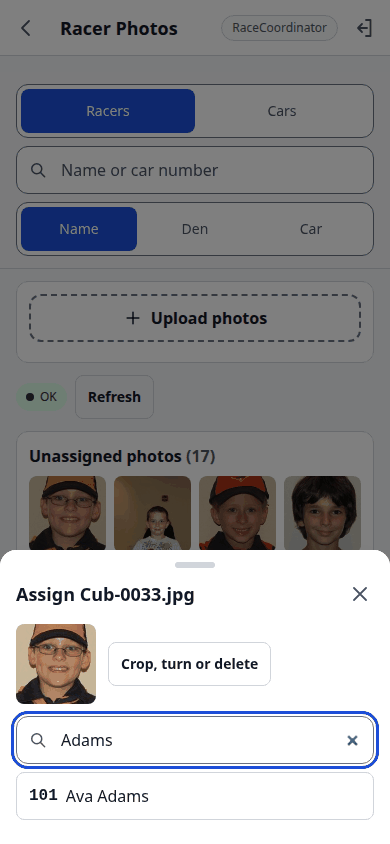
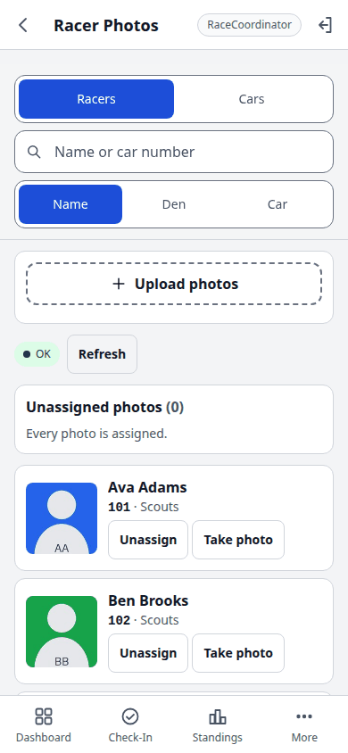
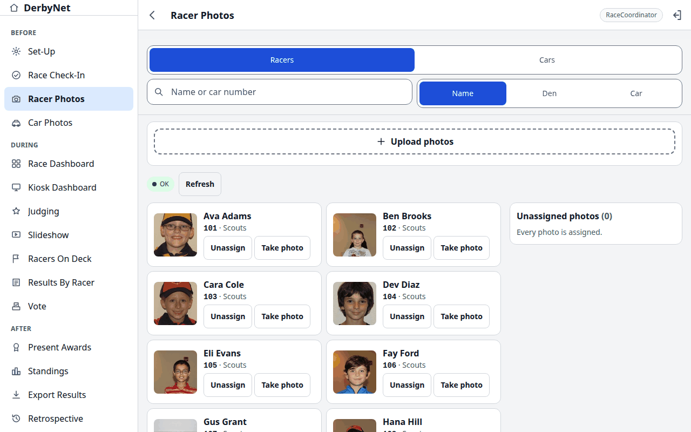

# Photo upload

Photos of the racers and their cars make the race day more fun. They show on the kiosks, on Results By Racer, in the award presentations, and on the ballot. This guide covers the ways to get photos to the server. Quoted words are the labels on the screen.

Each event keeps two kinds of photos, racer photos and car photos, each in its own folder. Settings, then "Photos and video", shows the two folders. To use another folder, type it and press "Check". The badge beside it says whether the folder is OK, read-only, missing, or outside the server's data folder.

## At check-in

The check-in crew takes the car's photo while the racer is at the desk. On a racer's card in Race Check-In, tap the car tile for the car photo, or the round tile with the racer's initials for the racer photo.

The sheet offers three ways to get the photo:

- "Take car photo", or "Take racer photo", opens the phone's camera. Take the picture, and the phone hands it to the page. This works over plain HTTP.
- The same button picks a photo already on the phone or the computer, such as one from a camera's memory card.
- "Use the live camera" shows the camera inside the page, with a "Capture" button. It shows only on a secure page, such as the server's HTTPS address (see [Secure contexts](secure-contexts.md)).

The page shrinks the photo before it uploads it, and says by how much.

"Capture and check in" uploads the photo and passes the racer, in one tap. "Capture only" uploads it and leaves the "Passed" switch alone. "Autocrop to the face", on at first for a racer photo, crops the photo to the face it finds.

The crop sheet opens next. Drag the box, or its corner, to frame the car. "Turn left" and "Turn right" turn the photo. Press "Crop", or "Keep as is" to keep the whole photo.

## Many photos at once

Racer Photos and Car Photos, in the menu, hold every photo of their kind. Use them when the photos were taken before the race, or by a photographer.

1. Press "Upload photos", and pick the photos. Pick many at once. The page lists each one as it uploads, and "Retry" sends one again if it failed.
2. The photos wait under "Unassigned photos". Tap one.
3. Search for its racer by name or car number, and tap the racer (D95). The photo moves to the racer's card.

You can start from the racer instead: tap the empty photo square on a racer's card, then tap the photo.

On each racer's card, "Unassign" puts the photo back with the unassigned ones, and "Take photo" opens the camera sheet. Tap a racer's photo to open the crop sheet. For an unassigned photo, tap it, then "Crop, turn or delete" in the sheet that opens. It has "Delete photo…" for a photo you do not want. "Racers" and "Cars" at the top switch between the two kinds.

## Photos from another program

The pages list each photo folder when they open. A photo file copied into the folder by another program, such as a Wi-Fi camera card's app, shows under "Unassigned photos". Press "Refresh" to list the folder again, for photos taken while the page was open. In the Docker image, the folders are on the data volume, so the program needs to write there.

## A photo stand

A photo stand takes car photos by itself as each car is scanned, and sends them to the server. Existing Raspberry Pi photo stands keep working.
