# Running a race

This guide walks through one race day from start to finish. The pack races two classes, Scouts and Outlaws. Each class races a first round, then a final for its top 4 (D11). One coordinator runs the whole day from a phone, and the pictures show the phone at 390 by 844. Pages that lay out differently on a computer have a second picture at 1280 by 800.

The pictures come from `server/tools/race_day_screens.py`, which plays this race day against a real server. Quoted words are the labels on the screen. [Quick reference](quick-reference.md) lists where to find each task.

## Before race day

Do these steps a day or more before the race. You need the server, but not the track or the timer. [Installing DerbyNet with Docker](install-docker.md) sets up the server.

### Start the event

Open the server's address in a browser. A new server opens Set-Up, at "Create or open an event". Type the event's name under "New event's name", and press "Start a new event".

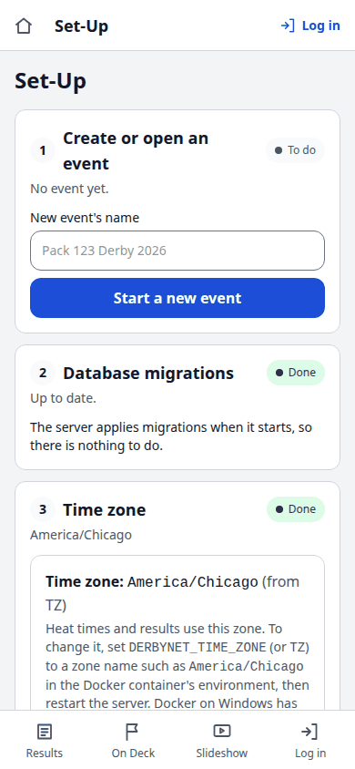

Starting the first event logs this browser in as RaceCoordinator. Each event keeps its own racers, results and photos. Set-Up, then "Events: copy, switch, archive, export", starts a later event, and can copy this one's settings, classes and awards (D14).

### Log in, and change the passwords

The login page lists the roles for people: RaceCrew and RaceCoordinator. "Show all roles" adds the roles for devices. The buttons below them turn the browser into a kiosk, a replay kiosk or a camera.

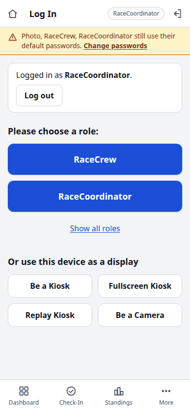

Until each default password is changed, a yellow banner says so on every page. "Change passwords" in the banner opens Roles and passwords. Type a new password for Photo, RaceCrew and RaceCoordinator, and press "Change password" under each. [Roles and passwords](roles-and-passwords.md) says what each role may do.

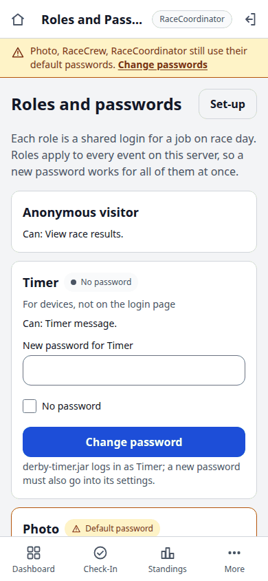

### Set the lanes

Open Settings from Set-Up. Under "Track", type the number of lanes in "Lanes on the track". It saves as you leave the field. "Lanes in use" leaves a damaged lane out of new schedules.

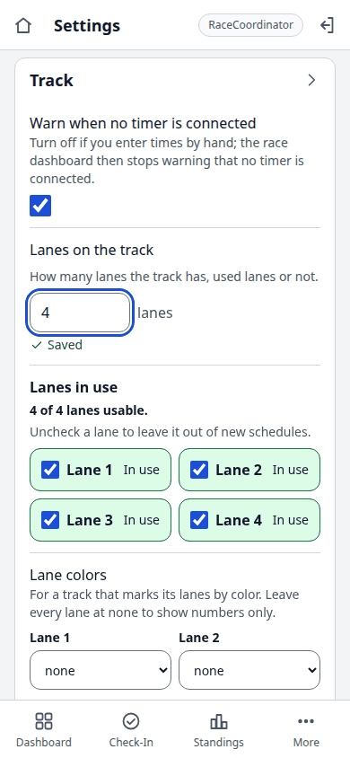

### Import the roster

Set-Up, then "Import roster". Choose a spreadsheet or a `.csv` file with one racer per row. The page reads the first row as the column names, and picks a field for each column. Check each one under "Match the columns". This roster has a column for the class, which becomes the den.

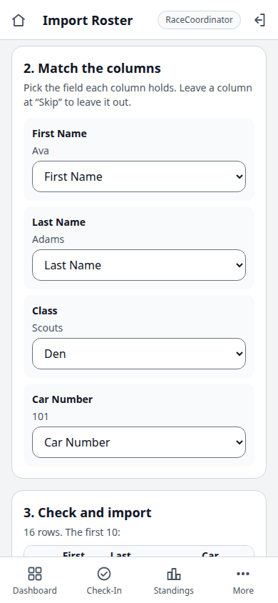

Press "Preview" to see the rows and the new dens. Then press "Import".

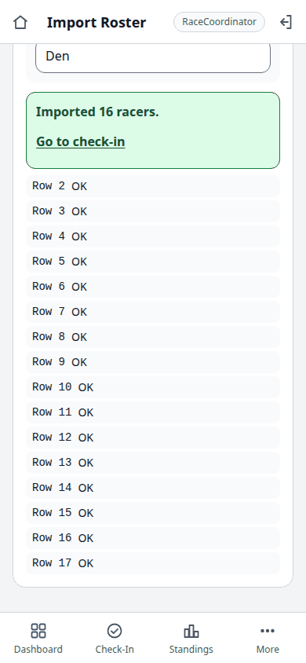

A racer who comes late is added at check-in, so the roster need not be complete. To practice with made-up racers instead, use Set-Up, then "Fake roster".

### Check the racing groups

Set-Up, then "Racing groups". Under "How racers are grouped", "By Den" makes each den race as its own group. Here that gives a Scouts group and an Outlaws group. "Speed trophies" sets how many speed awards go to the pack and to each den.

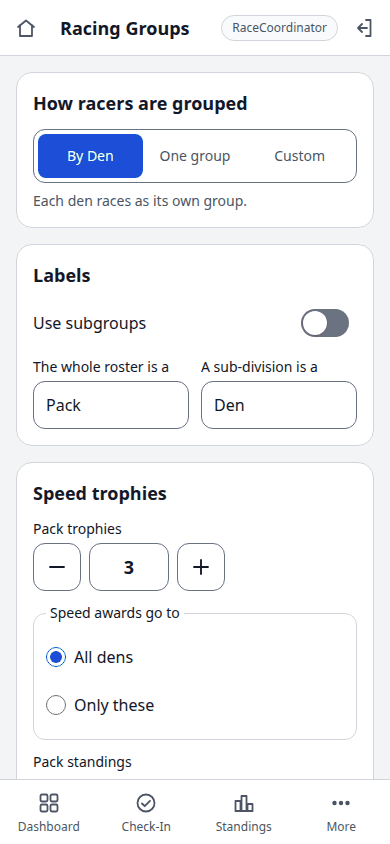

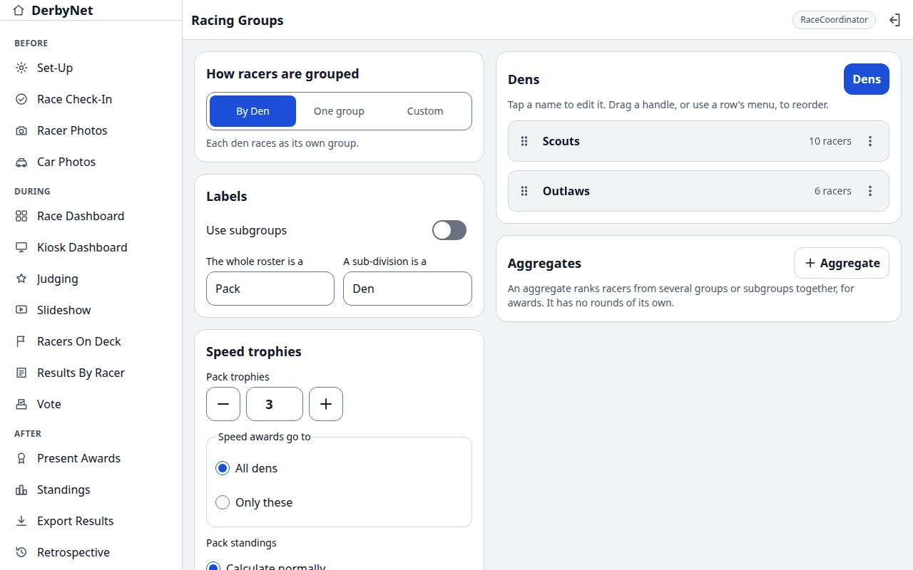

Tap a group's name to rename it. Drag a handle, or use the row's menu, to reorder the groups. "One group" and "Custom" are the other rules. Under them, each new den makes its own subgroup (D95).

### Set up the weigh-in

Settings, then "Weigh-in". Each den weighs its cars one of three ways: "No weigh-in", "Pass or fail", or "Recorded weight" (D8). Here the Scouts record each weight in ounces, with a 5 oz maximum. Press "Save" under the den. A car over the maximum still checks in, with a warning.

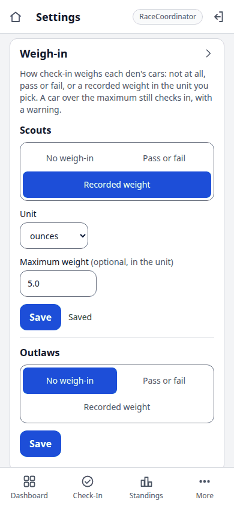

### Add the awards

The speed trophies need no setup. For a design award, open Judging, then "Edit awards", then "New award". Give it a name and a type, and press "Add award". Set-Up, then "Import awards", reads a list of awards from a file instead.

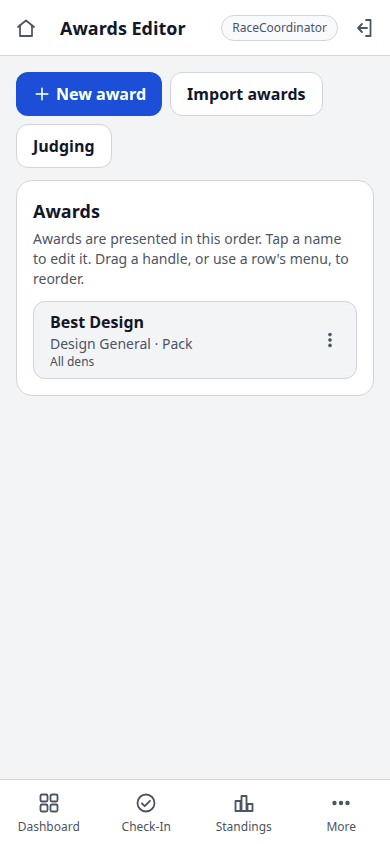

Here the pack adds "Best Design", which the families vote on (see [Online balloting](balloting.md)).

### Plan the rounds

Set-Up, then "Rounds playlist". The playlist is the order the rounds race in. Tap each round under "Rounds to add" to add it. A round 2 is a final: "How many racers go to this final?" sets how many of the round before it go on. Here each class sends its top 4.

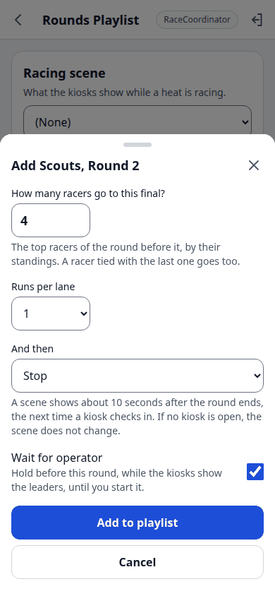

Each round after the first has "Wait for operator" turned on. The playlist then holds between rounds, while the kiosks show the leaders, until you start the next round (D12). That pause is the intermission. "And then" can also change the kiosks' scene when a round ends.

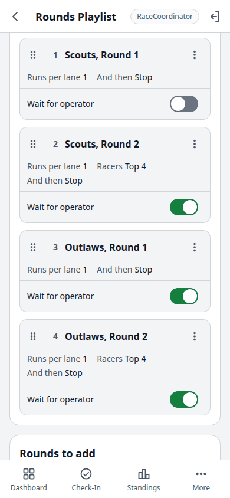

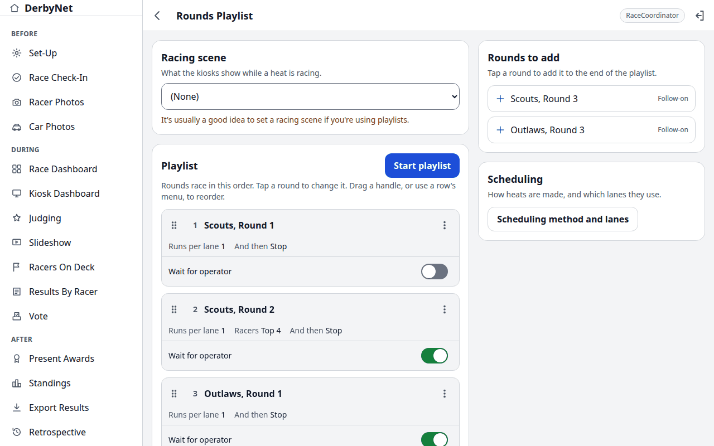

## Set up on race day

### The network

Every phone, tablet, kiosk and the timer computer must reach the server. Bring your own Wi-Fi router, rather than rely on the building's network. The camera, the browser timer and replay need the server's HTTPS address (see [Secure contexts](secure-contexts.md)).

### The timer

Plug the timer into a computer, and connect it with the browser timer. [Timer operation](timer-operation.md) covers the timer, the timer test, and the fake timer for practice. The race dashboard shows "Timer: CONNECTED" once it reports.

### Kiosks

A kiosk is any screen that shows the race: a TV, a projector, a second monitor. On that screen's browser, open `/kiosk.php`, or "Be a Kiosk" on the login page. No login is needed. Each kiosk appears on the Kiosk Dashboard.

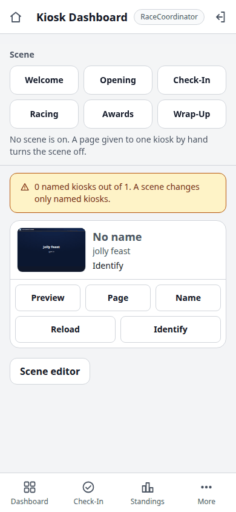

Tap a kiosk's "Name" and pick a name, such as Main. The scenes reach only named kiosks. A scene, such as Welcome or Racing, sets the page of every named kiosk at once. "Page" sets one kiosk's page by hand.

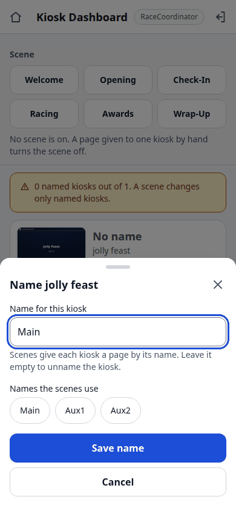

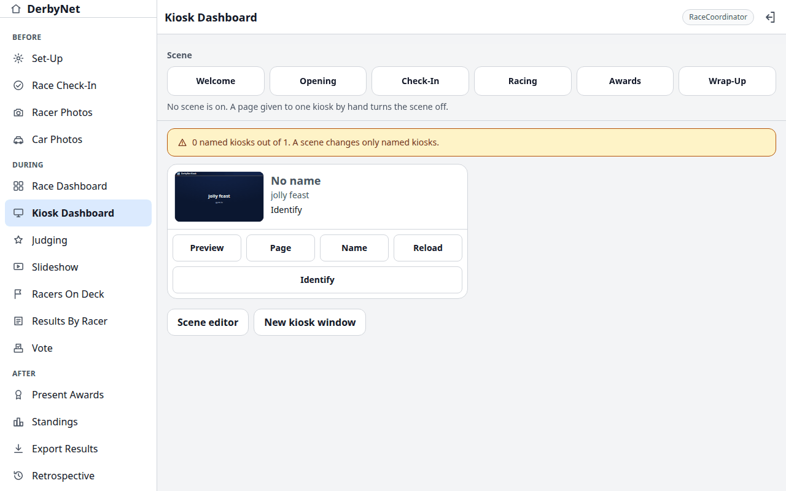

### Replay

The replay kiosk records the finish line with a camera, and plays each heat back after it finishes. On the computer beside the track, log in as RaceCoordinator, and press "Replay Kiosk" on the login page. Choose the camera, then press "Proceed". Click the kiosk to come back to the setup; right-click it to replay now.

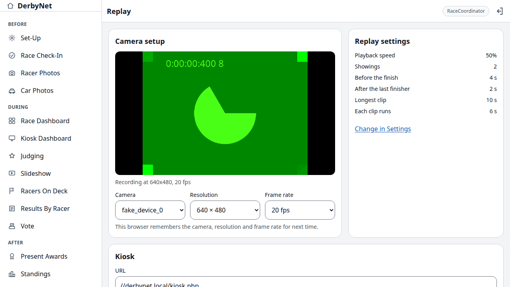

"Be a Camera" on the login page makes a phone the replay camera instead. The replay's speed and clip length are under Settings, then "Replay". "Trigger Replay" on the dashboard plays the last heat again.

## Check-in

The check-in crew logs in as RaceCrew on their phones, and opens Race Check-In. Find a racer by name or car number in the search field. The filters narrow the list by den, status and weigh-in.

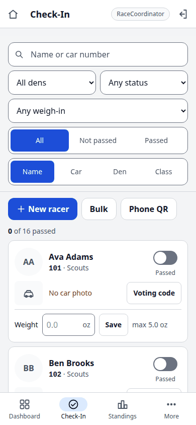

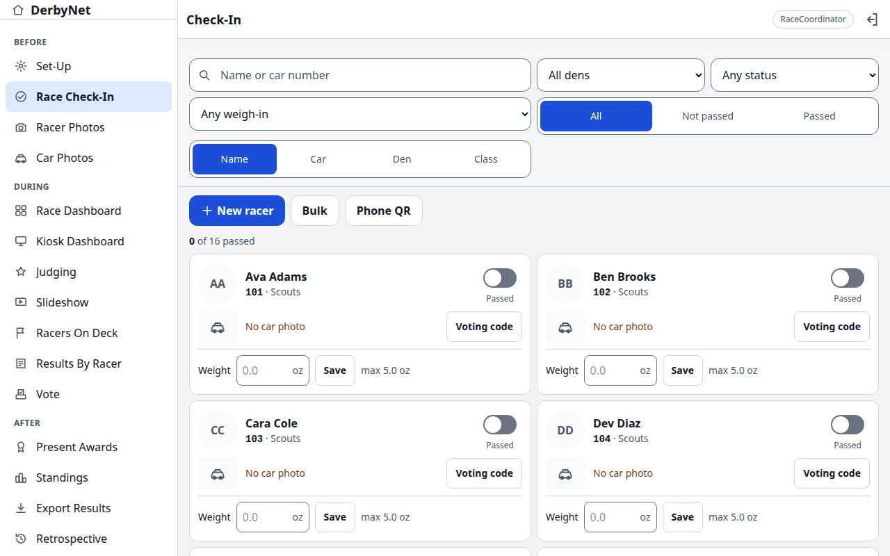

For each racer, in the order the station works (D6):

1. Weigh the car. Type the weight beside "Weight" and press "Save". The card shows it, and the den's maximum.
2. Tap the car tile to take the car's photo. [Photo upload](photo-upload.md) shows the photo steps.
3. "Capture and check in" saves the photo and passes the racer at once. The "Passed" switch on the card does the same alone.

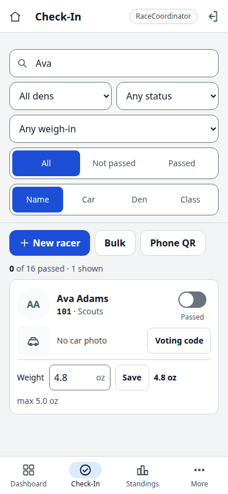

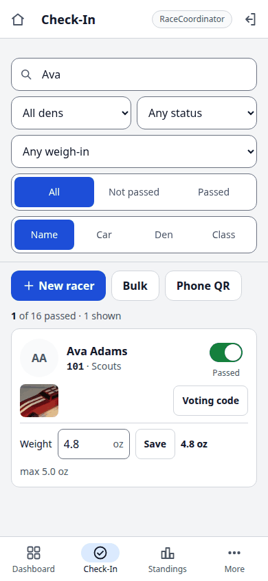

Tap a racer's name to change the name, the car name, the class or the car number. The sheet also weighs the car and takes the photos.

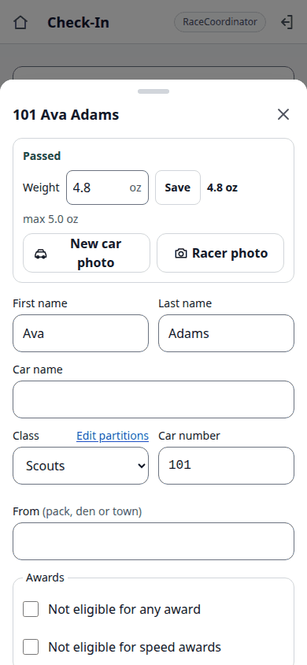

A racer missing from the roster is added with "New racer". Choose the class first: the car number fills in with the class's next number. Press "Add racer".

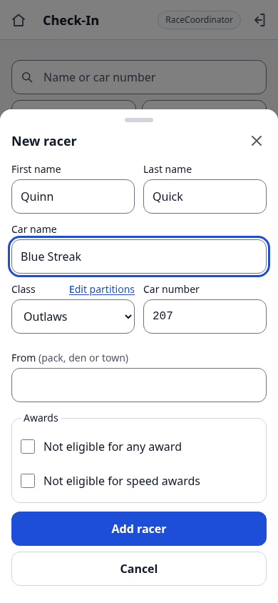

Other tools on the page:

- "Bulk" checks in a whole den at once, renumbers the cars, or changes award eligibility.
- "Phone QR" shows a code for a second phone to scan. That phone then checks racers in for 60 minutes, with no login.
- "Voting code" on each card is the racer's ballot (see [Online balloting](balloting.md)).

Only passed racers are scheduled. When every car is in, the count at the top of the list reads "17 of 17 passed".

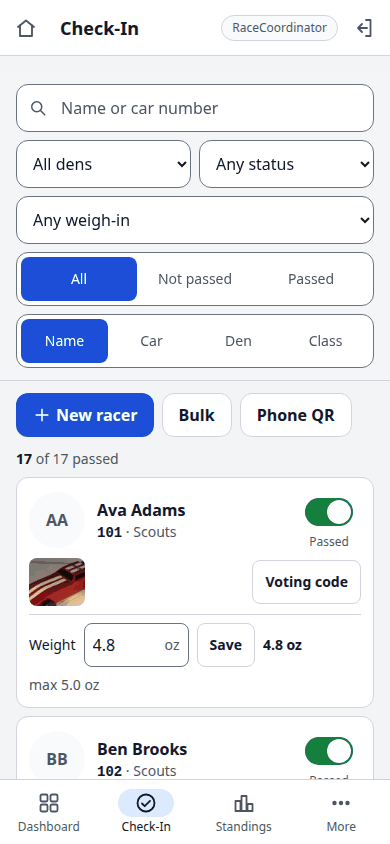

## Racing

The coordinator races from the Race Dashboard.

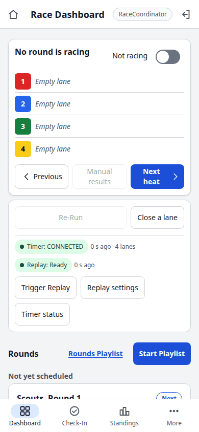

### Start the playlist

Press "Start Playlist". The first round is scheduled, and its first heat is staged for the timer. The heat card shows each lane's racer.

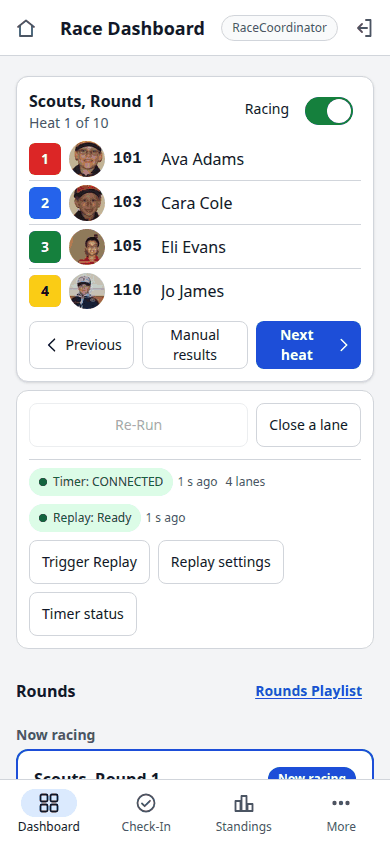

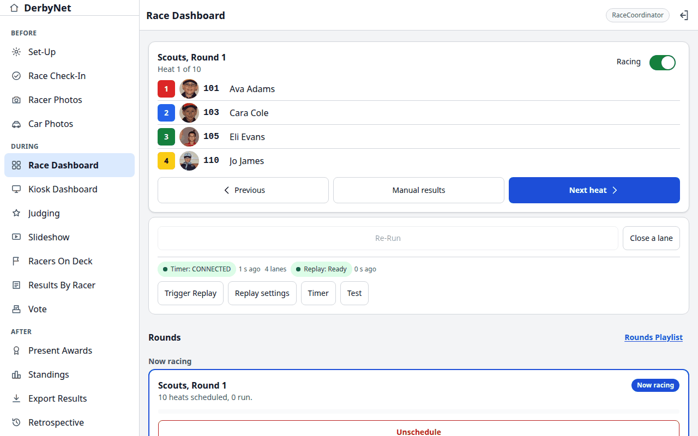

### Each heat

The starter drops the gate. The timer reports the times, the dashboard shows them, and the next heat is staged. The coordinator presses nothing.

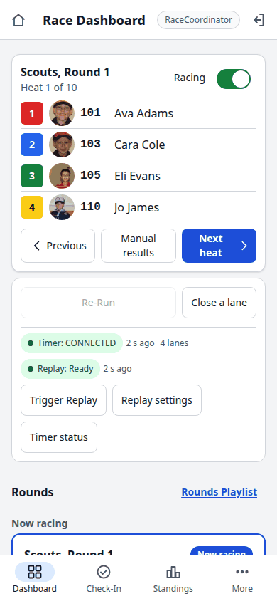

### The intermission

When a round ends, the playlist holds before the next one. The intermission card shows the round's leaders, and "Up next" names the next round. Present the leaders, then press "Start next round". The final takes the round's top 4.

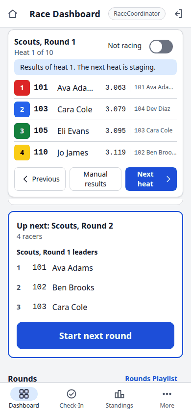

The same card holds after the Scouts final, and after Outlaws round 1. The playlist ends after the Outlaws final.

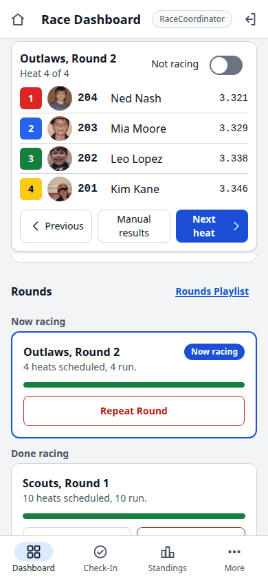

### When something goes wrong

- A car jumped the track: run the heat again. Once the heat has times, the button reads "Re-Run This Heat". When the next heat is already staged, it reads "Re-Run Previous". Either one discards the heat's results and races it again, and then reads "Reinstate Heat", which puts the results back.
- The timer missed a heat: "Manual results", type the times or the places, and press "Save results".
- A lane breaks: "Close a lane" takes it out of the heats still to race.
- A racer arrives late: their card at check-in has "Add to round…". Or on the dashboard, "Not in the schedule", then "Preview and add".
- A round must race again: "Repeat Round" on its card. It deletes the round's results.
- "Previous" and "Next heat" move between heats. The switch on the heat card turns racing off and on.

## Results

Results By Racer shows every racer's time in each heat and lane, with both photos. Anyone may open it, with no login (D5).

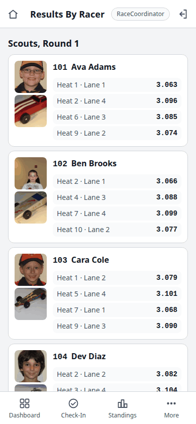

Standings ranks the racers by average time. "Standings for" picks the pack, a den, or one round. Standings needs no login either.

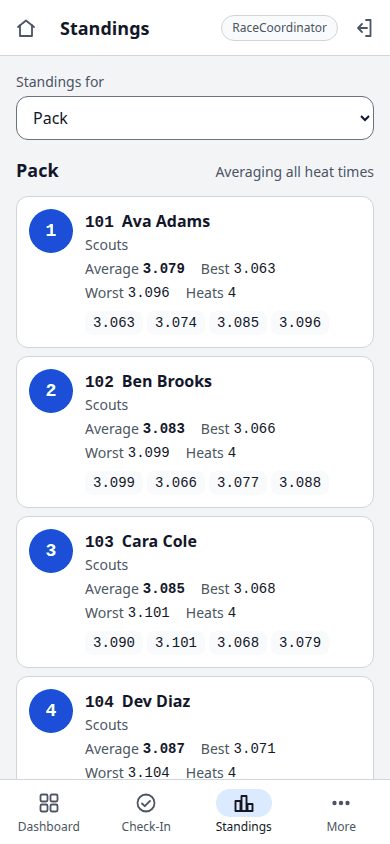

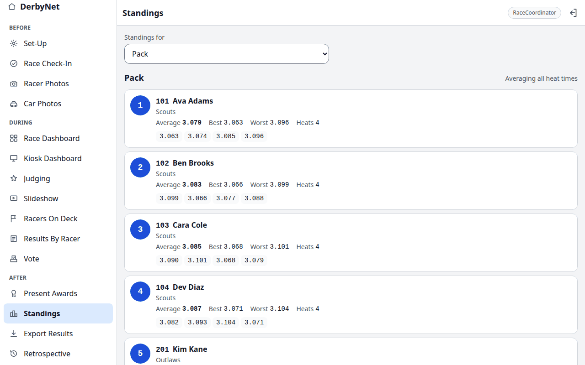

## Awards

### Judging

Judging lists the awards and the racers. Tap an award to see the racers who can win it, then tap the winner (D95). Or tap a racer to give them an award.

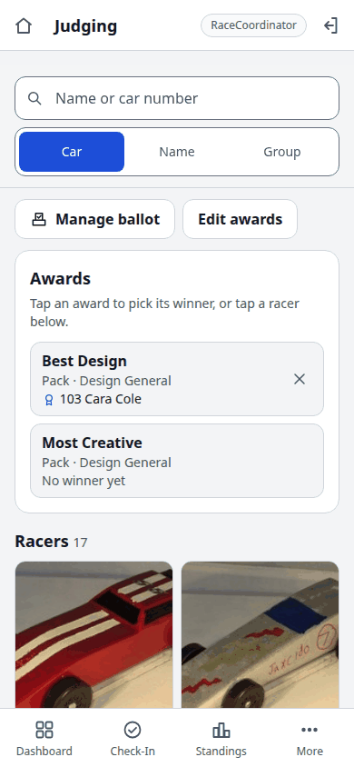

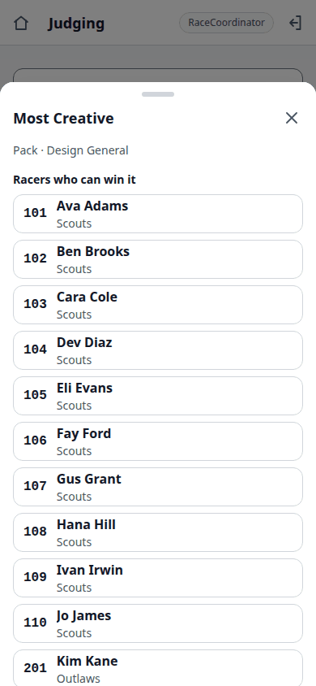

"Manage ballot" opens the vote on the design awards. [Online balloting](balloting.md) walks through it.

### Present the awards

Give one kiosk the "Award presentations" page on the Kiosk Dashboard. Then open Present Awards. Tap an award to put it on the kiosk, hidden. Tap "Reveal" to show the winner, and "Next award" to move on. "Clear the kiosk" leaves the kiosk empty.

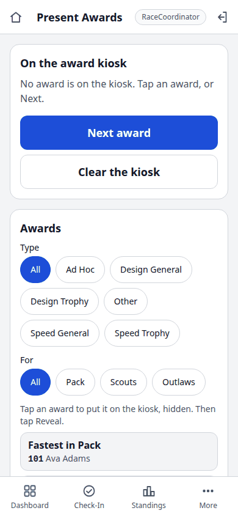

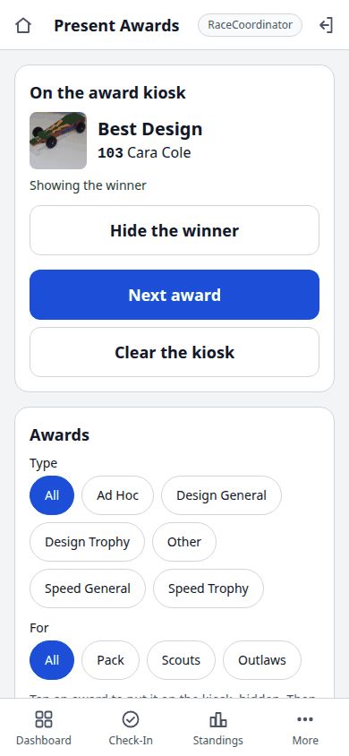

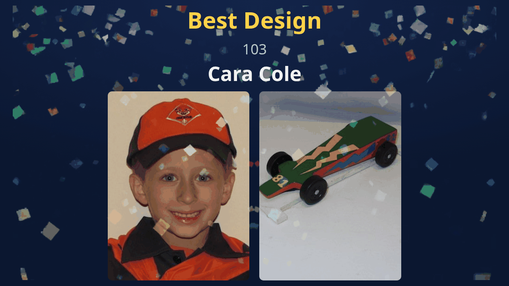

## After the race

Export Results downloads the roster, every result, each standings view and the awards. "Everything as .xlsx" and "Everything as .ods" give one sheet each. Each sheet also downloads alone as `.csv`, and the same data comes as JSON for other programs.

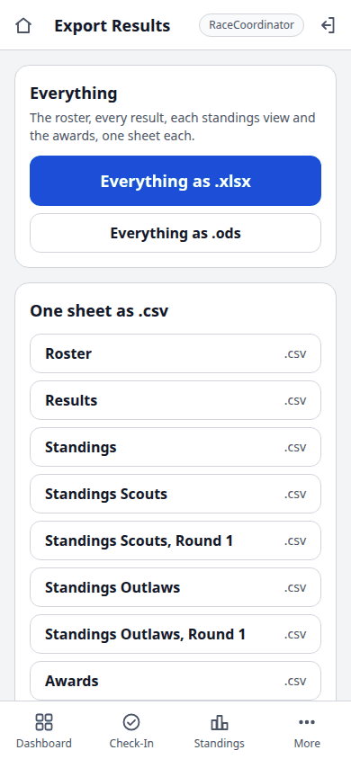

Set-Up, then "Snapshots", then "Snapshot, complete", saves the whole event in one file. Retrospective lists the day's events in order, and checks the track for lane bias.
