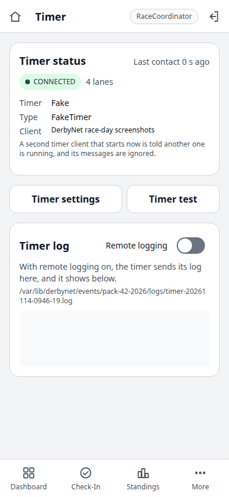
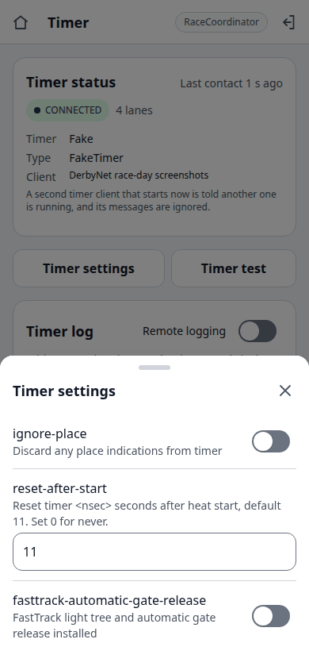
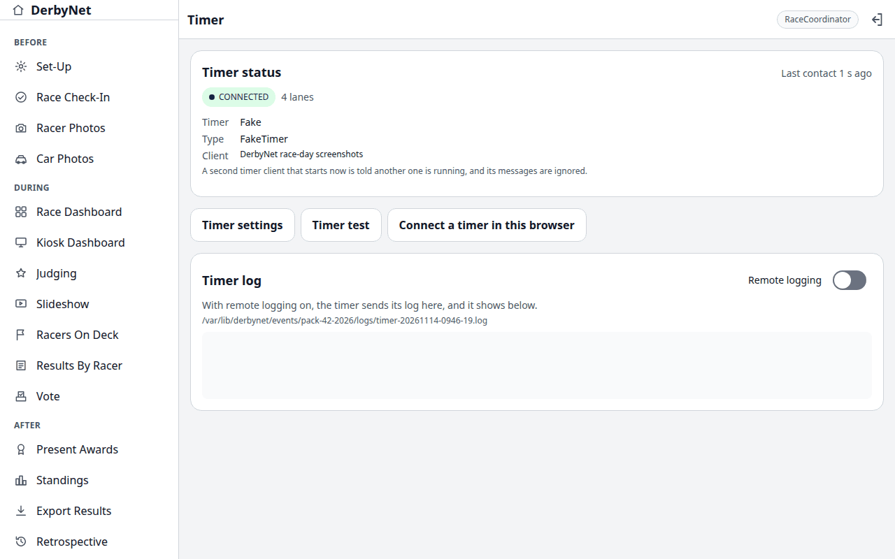
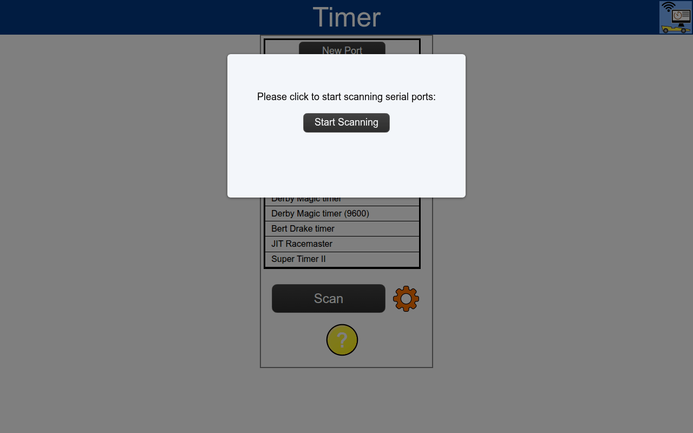
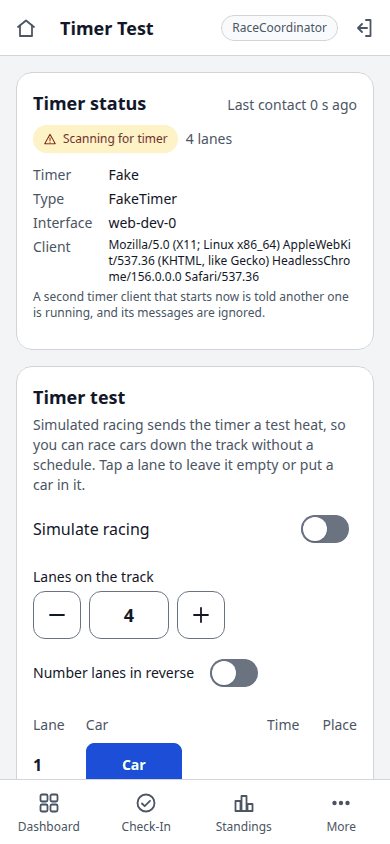
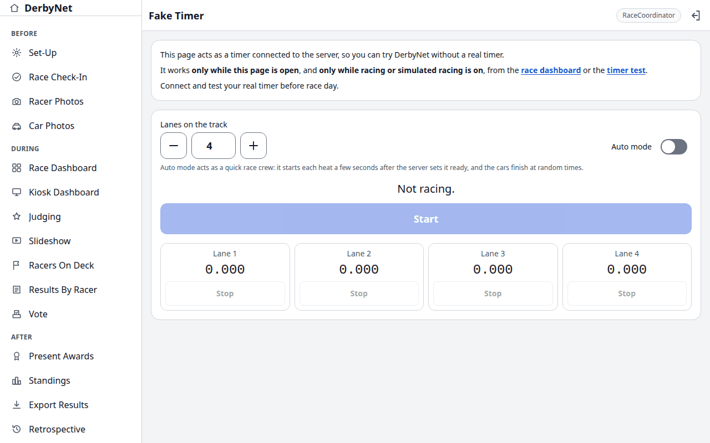

# Timer operation

The track timer reports each heat's times to the server, so nobody types them. The timer plugs into a computer by USB or a serial cable. A timer client on that computer reads the timer and sends each heat to the server. DerbyNet has two:

- The browser timer, a page of the server that talks to the timer through Chrome or Edge. It is the supported timer client (D4).
- `derby-timer.jar`, the Java program from earlier versions of DerbyNet. It still works, through the same messages ([The timer protocol](dev-timer-protocol.md)).

Quoted words below are the labels on the screen.

## The timer page

On a phone, open the timer page with "Timer status" on the race dashboard, or open `/timer/`. It needs a RaceCoordinator login. "Timer status" shows whether a timer client is connected, the last time it reported, the number of lanes, and the timer's type.



Only one timer client reports at a time. A second one that starts is told another one is running, and its messages are ignored.

"Timer settings" shows the settings the timer client reported, such as how long it waits to reset the timer after a heat. A change goes to the timer client with its next message.



On a computer, the page has "Connect a timer in this browser", which opens the browser timer. The dashboard on a computer has "Timer", which opens it too, and "Test", which opens the timer test.



When the timer offers a remote start, "Start Race" on the dashboard and on the timer page opens the gate.

## The browser timer

The browser timer needs three things:

- Chrome or Edge on a computer. They are the browsers with Web Serial. Phones and Safari do not have it.
- The server's HTTPS address, such as `https://192.168.1.20/timer.php`. Web Serial works only on a secure page (see [Secure contexts](secure-contexts.md)). On the computer that runs the server, `http://localhost/timer.php` works too. Over plain HTTP to another computer, the page says to use the HTTPS address instead.
- A RaceCoordinator login in that browser.

On the computer the timer is plugged into, open "Connect a timer in this browser" on the timer page, or `/timer.php`. Press "Start Scanning", then choose the timer's serial port in the browser's list. The browser asks once for each port. The page then tries each kind of timer it knows on that port.



A timer that answers is found by the scan. Two kinds never answer: the FastTrack P-series, and the NewBold DT, TURBO and DerbyStick. For those, click the timer's name in the list. The list is:

- "The Champ" (SmartLine/BestTrack), and "The Champ" (SRM)
- FastTrack K- or Q-series, and FastTrack P-series
- The Judge (New Directions)
- NewBold DT, TURBO, or DerbyStick
- Derby Timer
- PDT timer (<https://www.dfgtec.com/pdt>)
- Derby Magic timer, and Derby Magic timer (9600)
- Bert Drake timer
- JIT Racemaster
- Super Timer II

A browser may slow a page that is out of sight. Keep the browser timer's window open and in view during the race.

The browser timer page in the v0.1.0-rc1 image cannot load its scripts, so it never shows the scan (#312). Until a release fixes it, connect the timer with `derby-timer.jar`. The page works when the server runs from a checkout.

## Test the timer

Before race day, test the timer on the track. Open "Timer test" on the timer page. Turn on "Simulate racing", and the server sends the timer a test heat with no schedule. Tap a lane to leave it empty or put a car in it. Race cars down the track, and the times and places show in the table.



"Number lanes in reverse" is for a track whose lane 1 is on the other side. "Lanes on the track" changes the lane count. Turn "Simulate racing" off when you are done.

## The fake timer

The fake timer stands in for a timer, to practice with no track. Open `/timer/fake/` on any computer, logged in as RaceCrew or RaceCoordinator. It works only while its page is open, and only while racing or simulated racing is on.



"Start" starts the heat, and "Stop" under each lane finishes that car. "Auto mode" races each heat by itself a few seconds after it is staged, with random times.

## Racing with no timer

Turn off Settings, then "Track", then "Warn when no timer is connected". The dashboard then stops warning about the timer. For each heat, press "Manual results" on the dashboard, type the times or the places, and press "Save results".

## derby-timer.jar

`derby-timer.jar` needs Java. Docker Desktop cannot pass a USB device into the container (D3), so on a Mac or Windows laptop it runs outside Docker, like the browser. On a Linux server it runs on the host, beside the container.

Start it with a double-click, or from a command line. With no options it opens a window. Type the server's address on the left, and press "Connect". The right side picks the timer's serial port.

To run it with no window, give `-x` and the server's address:

```sh
java -jar derby-timer.jar -x http://localhost/
```

`-h` lists every option, and the timers it knows by their short names. For a timer that never answers, name its port with `-n` and its type with `-d`:

```sh
java -jar derby-timer.jar -x -n /dev/ttyUSB0 -d FastTrackPSeries http://localhost/
```

If you gave Timer a password on Roles and passwords, add `-p` and the password.

`-simulate-timer` connects a pretend timer to the server, as the fake timer does:

```sh
java -jar derby-timer.jar -x -simulate-timer -lanes 4 http://localhost/
```

`derby-timer.jar` can also send OBS a hot key when a heat starts or finishes (see [Live streaming](live-streaming.md)).

## Timer logs

When the timer misbehaves, its log shows each line between the timer client and the timer.

- Turn on "Remote logging" on the timer page. The timer client then sends its log to the server, and the page shows it below the switch, with the file's place on the server.
- `derby-timer.jar` also writes its own log, a file named `timer-` and the date, ending in `.log`. It goes in the folder it was started from, or in the folder `-logdir` names.

If a scan finds no timer, check that the timer is on and the cable is in. Then read the log for any line from the timer. With no line at all, suspect the cable.
